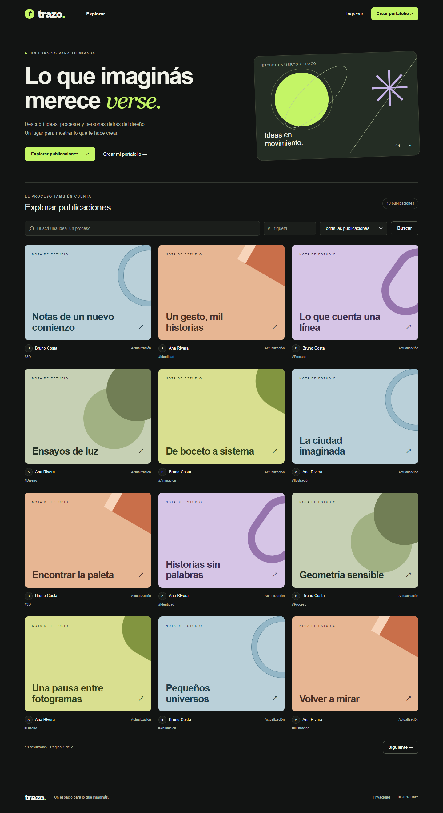

# Trazo · Portafolios creativos

Proyecto Integrador Final de **Laboratorio II**. Autor: **Muñoz, Jonathan**.

Trazo reúne portafolios de diseño, ilustración y animación con descubrimiento por etiquetas. Los reclutadores pueden navegar sin cuenta; cada creador decide la visibilidad de su perfil, publicaciones y contacto profesional. Busca resolver la dispersión de trabajos y datos de contacto entre redes generalistas y sitios personales.

**Estado al 24/10/2026: segundo incremento funcional local.** Además de cuentas, perfiles/avatar, exploración y etiquetas administrativas, ya funciona el **ABM de publicaciones con Vue 3 vía AJAX/JSON**, con borradores, publicación, archivo, privacidad y búsqueda asíncrona de etiquetas. Los medios adicionales, JWT y las funciones sociales siguen pendientes.



## Ejecución local

Requisitos: .NET SDK **10.0.400**, Docker Desktop con motor Linux activo, **PowerShell 7.2 o superior**, Git y VS Code. No hace falta instalar MySQL directamente ni modificar bases de otros proyectos. El JavaScript compilado de Vue está incluido: **Node no es necesario para ejecutar la web**. Para modificar sus componentes se requiere Node >=22.12 y `npm ci` / `npm run build`.

En una terminal PowerShell de VS Code, abierta en la raíz del repositorio:

```powershell
./tools/Preparar-Entorno.ps1
dotnet dev-certs https --trust
dotnet run --project src/Trazo.Web --launch-profile https -- --seed-demo
dotnet run --project src/Trazo.Web --launch-profile https
```

Abrir **https://localhost:7280**. El comando `--seed-demo` aplica migraciones, crea roles y carga datos ficticios; termina sin iniciar el servidor. La última línea inicia la web. El certificado requiere la confirmación del sistema operativo la primera vez. Usar HTTPS para que funcionen las cookies de sesión.

El script genera contraseñas aleatorias en `.env` y configura la conexión mediante .NET User Secrets. Estos secretos, la base y los archivos subidos **no se versionan**. MySQL queda disponible solo en la máquina local, en `127.0.0.1:3307`. Para detenerlo conservando los datos: `docker compose stop`.

La [guía de desarrollo](docs/desarrollo.md) explica cada paso, la conexión desde Workbench, las migraciones, las pruebas y el primer push.

Para usar el editor: ingresar y abrir **Mi estudio → Administrar mis publicaciones**, o `/panel/publicaciones`. Se pueden crear y publicar actualizaciones de texto; una obra sin recursos solo puede guardarse como borrador o archivada. Este incremento no cambia el esquema ni requiere otra migración.

## Cuentas de demostración

Disponibles después de ejecutar `--seed-demo`, exclusivamente en Development. Contraseña común: **`Trazo.Demo2026!`**. Son credenciales ficticias públicas para evaluación local; no deben reutilizarse en un despliegue.

| Correo de acceso | Roles | Perfil |
| --- | --- | --- |
| `ana@trazo.test` | Creador | `/p/ana` |
| `bruno@trazo.test` | Creador | `/p/bruno` |
| `admin@trazo.test` | Creador, Administrador | `/p/admin` |

Los datos iniciales incluyen 6 etiquetas, 18 actualizaciones públicas y 3 casos de Ana: una publicación para registrados, una privada y un borrador. Las portadas geométricas están hechas con CSS; no simulan archivos multimedia cargados. El administrador tampoco puede leer publicaciones privadas ajenas.

## Arquitectura y versiones

Un proyecto **ASP.NET Core MVC/Razor** con EF Core y MySQL; ASP.NET Core Identity administra usuarios, roles y cookies. Los controladores reciben modelos de formulario explícitos y las reglas de lectura se aplican en consultas antes de contar y paginar. El avatar se decodifica y convierte a PNG fuera de `wwwroot` y se sirve con autorización.

| Componente | Versión / situación |
| --- | --- |
| .NET SDK / destino | 10.0.400 / net10.0 |
| Identity, EF Core Design y herramienta EF | 10.0.13 |
| Proveedor MySql.EntityFrameworkCore | 10.0.9 |
| MySQL | Imagen Docker 8.4; ejecución local comprobada con 8.4.11 |
| SkiaSharp | 4.153.1 |
| Bootstrap | 5.3.3, archivos locales |
| Vue | 3.5.44, componentes precompilados e integrados en MVC |
| Vite / plugin Vue | 8.3.5 / 6.0.10, herramientas de compilación |
| Playwright | 1.64.1, recorrido local de evidencia en Edge |
| Web API con JWT / colección Postman | Próximos incrementos, aún no implementados |

Las dependencias NuGet están fijadas en los proyectos y en `packages.lock.json`. Docker sigue los parches de la rama 8.4. No se utilizan ADO.NET directo, SignalR ni un frontend separado: no son necesarios para esta fase.

Las dependencias del editor están fijadas en `package-lock.json`. Los endpoints `/panel-json/` usan **cookies y antiforgery**, y devuelven JSON; no equivalen al requisito de API autenticada con JWT. Vue se compila antes de servirlo, conservando la CSP sin `unsafe-eval` ni scripts inline.

```text
src/Trazo.Web/          Aplicación MVC
  Controllers/         Rutas públicas, cuenta, perfil y administración
  Domain/              Entidades y enumeraciones
  Data/                DbContext, migraciones e inicializador de datos
  Services/            Autorización de lectura, consultas y avatar
  Models/              Formularios, DTO y paginación
  ClientApp/           Componentes Vue del editor y selector de etiquetas
  Views/ y wwwroot/    Razor y recursos de interfaz
tests/Trazo.Tests/     Pruebas unitarias e integración con MySQL real
database/             SQL del esquema e inicialización de la base de pruebas
docs/                 Propuesta, DER, instrucciones y evidencias
tools/                Preparación del entorno y ejecución de pruebas
```

## Matriz de evidencias de requerimientos mínimos

Se prioriza el mínimo de **6 entidades principales** de la consigna, aunque su tabla de ejemplo diga 4. No se considera que tener una tabla equivalga a completar su módulo funcional.

| Requerimiento | Estado real | Código / controladores | Evidencia |
| --- | --- | --- | --- |
| 1. Al menos 6 entidades principales, 1:N y N:M | Implementado en persistencia: 7 principales, asociaciones y soporte Identity | [Modelo](src/Trazo.Web/Domain/Modelo.cs), [DbContext](src/Trazo.Web/Data/TrazoDbContext.cs), [migración](src/Trazo.Web/Data/Migrations/20261021051003_ModeloInicial.cs) | [DER](docs/der.png), [correspondencia física](docs/modelo-de-datos.md), [SQL](database/001-modelo-inicial.sql), pruebas con MySQL |
| 2. Login/logout, roles y avatar | Implementado y probado localmente | [Cuenta](src/Trazo.Web/Controllers/CuentaController.cs), [Perfil](src/Trazo.Web/Controllers/PerfilController.cs), [etiquetas solo administrador](src/Trazo.Web/Controllers/EtiquetasController.cs), [avatar](src/Trazo.Web/Services/AvatarService.cs) | [Login](docs/evidencias/login.png), [edición de perfil](docs/evidencias/perfil-editar.png), [pruebas de acceso y subida](tests/Trazo.Tests/MySqlIntegrationTests.cs) |
| 3. Archivos adicionales al avatar | Pendiente | Existe la entidad RecursoMultimedia; falta el flujo de archivos de publicación | Captura de subida pendiente; el avatar no cumple este punto adicional |
| 4. ABM completo Vue + AJAX/JSON | Implementado y probado para publicaciones de texto; medios pendientes | [Componente Vue](src/Trazo.Web/ClientApp/publicaciones/PublicacionesApp.vue), [controladores JSON](src/Trazo.Web/Controllers/PublicacionesJsonController.cs), [servicio](src/Trazo.Web/Services/PublicacionesService.cs) | [Video del ABM](docs/evidencias/incremento-02/editor-abm.webm), [red: cero recargas](docs/evidencias/incremento-02/red.json), [pruebas](tests/Trazo.Tests/PublicacionesIntegrationTests.cs) |
| 5. Paginado desde el servidor | Implementado en los listados actuales; debe mantenerse en los próximos | [Pagina](src/Trazo.Web/Models/Pagina.cs), [Explorar](src/Trazo.Web/Controllers/ExplorarController.cs), [Perfil](src/Trazo.Web/Controllers/PerfilController.cs), [servicio del panel](src/Trazo.Web/Services/PublicacionesService.cs) | [Respuesta de página 2](docs/evidencias/incremento-02/paginacion.json), [captura](docs/evidencias/incremento-02/paginacion.png), [peticiones](docs/evidencias/incremento-02/red.json); pruebas de páginas de 12 registros y selector de 10 |
| 6. Búsqueda asíncrona de relacionados | Implementada y probada: etiquetas de publicaciones | [Selector Vue](src/Trazo.Web/ClientApp/publicaciones/SelectorEtiquetas.vue), [búsqueda JSON](src/Trazo.Web/Controllers/PublicacionesJsonController.cs) | [Captura](docs/evidencias/incremento-02/selector-etiquetas.png), [video](docs/evidencias/incremento-02/editor-abm.webm); relaciones N:M persistidas y comprobadas |
| 7. Web API REST con JWT | Pendiente | La sesión MVC actual usa cookies | Endpoints JWT y colección Postman pendientes |

## Pruebas

```powershell
./tools/Probar.ps1                 # Unitarias; omite las que necesitan MySQL
./tools/Probar.ps1 -Integracion     # Suite completa, con Docker iniciado
```

La integración **recrea únicamente `trazo_tests` en localhost**; no usa `trazo_dev`. Resultado actual: **26 pruebas aprobadas, 0 fallidas y 0 omitidas** con MySQL real. Incluye las 19 del primer incremento y 7 nuevas de ABM, privacidad, CSRF en JSON, concurrencia, validación de etiquetas, paginación y conservación de reportes. Ver [registro del incremento 02](docs/incremento-02.md) y [antecedente del incremento 01](docs/incremento-01.md).

El [workflow de GitHub Actions](.github/workflows/ci.yml) compila Vue, comprueba que el bundle versionado corresponda a sus fuentes y ejecuta las pruebas .NET con MySQL. La ejecución remota de esta actualización queda pendiente del push; no se presenta como CI aprobada. Estas verificaciones no equivalen a una auditoría de seguridad ni cubren funcionalidades aún no construidas.

Con la web y MySQL encendidos, se puede repetir el recorrido de navegador en Windows con Edge:

```powershell
npm ci
npx playwright install ffmpeg
npm run test:browser
```

Usa la cuenta demo Ana y crea/elimina una publicación temporal en `trazo_dev`. Requiere suficientes publicaciones para una segunda página (la semilla original incluye 12 de Ana). Genera video, capturas y metadatos de red sin cookies ni tokens en `docs/evidencias/incremento-02/`.

## Documentación y pendientes de entrega

- [Entrega preliminar PDF](output/pdf/entrega-preliminar-trazo.pdf), [fuente](docs/entrega-preliminar.md) y [DER Mermaid](docs/der.mmd).
- [Plan de trabajo y antecedentes de seguridad y marco legal argentino](docs/plan-de-trabajo.md).
- [Desarrollo en VS Code y MySQL](docs/desarrollo.md), [modelo físico](docs/modelo-de-datos.md) y [dependencias de terceros](docs/dependencias.md).

Para promoción faltan los módulos señalados, funciones sociales y moderación, datos multimedia, SQL con datos ficticios completos, colección Postman, documentación y evidencias finales, y ensayo de instalación y defensa. El SQL actual contiene el **esquema**; los datos se generan con el inicializador C#.

Para producción se requiere otra etapa: recuperación y confirmación de cuentas, revisión de seguridad y operación, tratamiento de datos personales, términos y privacidad aplicables, licencias, copias de seguridad y gestión de incidentes. La página de privacidad actual informa el estado de desarrollo; no es una política legal definitiva.
